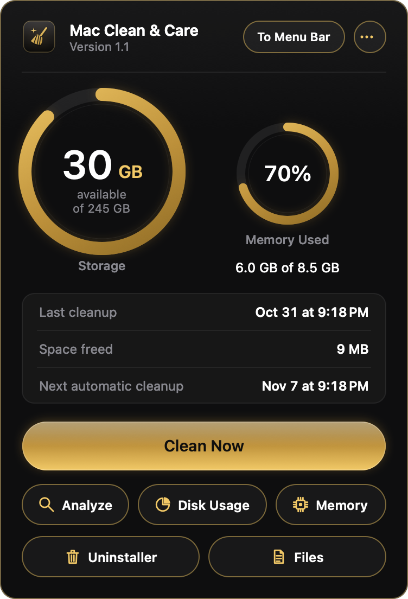
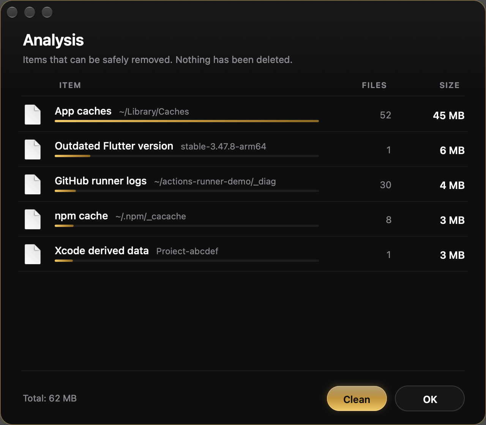
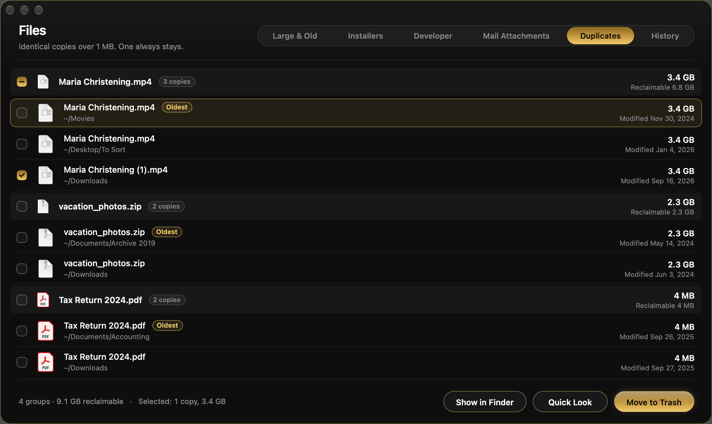
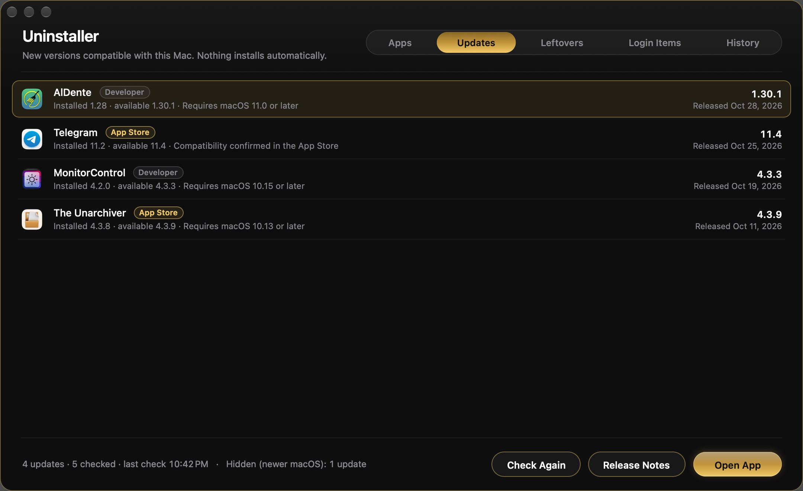
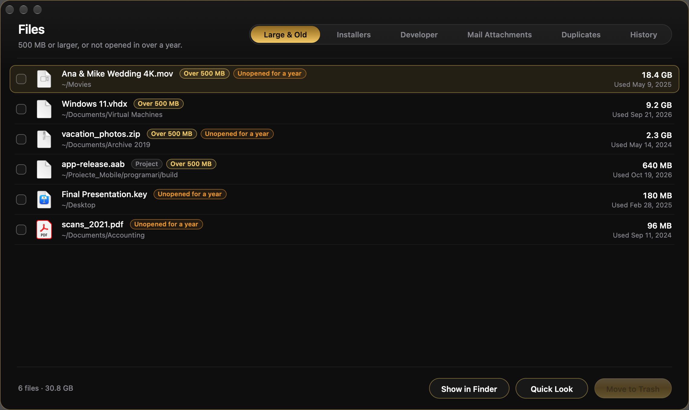
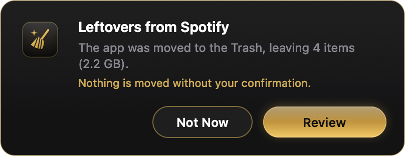
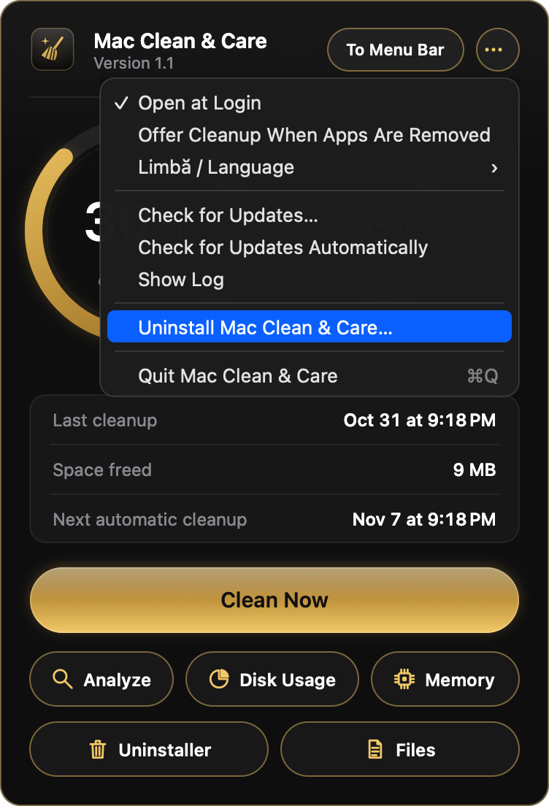

<p align="center">
  
</p>

<h1 align="center">Mac Clean &amp; Care</h1>
<p align="center"><b>Clean, Uninstall &amp; Care for Your Mac</b><br>A careful, beautiful menu bar app that keeps your Mac clean, light and up to date.</p>

<p align="center">
  <a href="https://github.com/Lexod24/mac-clean-and-care-releases/releases/latest"><b>Download the latest version</b></a>
  &nbsp;·&nbsp; macOS 10.13 High Sierra or later &nbsp;·&nbsp; Intel and Apple silicon
</p>

---

Mac Clean & Care lives in your menu bar. One click shows how much storage and memory you have, when the last cleanup ran,
and what can safely be cleared. It never deletes anything without asking, and everything it moves goes to the Trash,
so you can always change your mind.

## Features

**Clean Now and automatic cleanup**
- Clears outdated caches, old logs, Xcode derived data, stale Gradle, Android and iOS Simulator caches, and log files older than 30 days.
- Automatic cleanup runs at most once every 7 days, and only after you agree to it the first time.
- Your documents, photos, downloads, email, messages, passwords and browsing history are never touched.

**Analyze** shows exactly what would be removed and how much space you would get back, without removing anything.

**Disk Usage** lists the largest folders in your home folder, read only.

**Memory** shows open apps sorted by memory use. You can quit an app after a confirmation.

**Uninstaller**
- **Apps:** every installed app with its true size (the app plus its files), last use and source (App Store, package, Homebrew, direct download). Includes search, sorting and an “Unused for 3 or 6 months” filter. Uninstall moves the app and its related files to the Trash. Reset clears only preferences, caches and saved state.
- **Updates:** new versions of your apps from their own update feeds (Sparkle, over HTTPS) or the App Store. Only versions compatible with your macOS are shown. Nothing is installed for you.
- **Leftovers:** files left behind by apps you already removed. Every item is checked again right before it is moved.
- **Login Items:** agents and services that start automatically. Each one carries a signature badge: Apple, App Store, Signed (with the developer's name), Ad-hoc signed, Unsigned, Invalid signature or Program missing.
- **History:** every operation, with one-click restore for items still in the Trash.
- **Trash offer:** when you drag an app to the Trash and it leaves files behind, a discreet offer appears. Review the files or dismiss it.

**Files**, a review-only window where nothing is pre-selected:
- **Large & Old:** files of at least 500 MB, or unopened for over a year.
- **Installers:** old .dmg, .pkg and archive installers, plus leftover “Install macOS” apps.
- **Developer:** unused iOS device symbols, Xcode archives and Homebrew cleanup (only on request).
- **Mail Attachments:** copies of attachments you opened from Mail.
- **Duplicates:** identical files over 1 MB, matched by size and then by SHA-256 content. At least one copy of every file always stays.
- **History:** restore anything you moved.

**English and Romanian.** The interface follows your Mac's language automatically. You can also choose it under ⋯ › Limbă / Language.

**Automatic updates.** Mac Clean & Care checks for new versions once a day (you can turn this off). Updates install only after you confirm, and every update is cryptographically signed (EdDSA) and verified before it is installed.

## Screenshots

| Main panel | Analyze | Files · Duplicates |
|---|---|---|
|  |  |  |

| Uninstaller · Updates | Files · Large & Old |
|---|---|
|  |  |

| Trash offer | Options menu |
|---|---|
|  |  |

<sub>Screenshots use sample data.</sub>

## Supported Macs

| | Minimum macOS |
|---|---|
| Intel Macs | macOS 10.13 High Sierra |
| Apple silicon (M-series) | macOS 11 Big Sur |

One universal app runs natively on both.

## Installation

1. Download `Mac_Clean_and_Care-<version>.zip` from the [latest release](https://github.com/Lexod24/mac-clean-and-care-releases/releases/latest) and open it.
2. Move **Mac Clean & Care** to your **Applications** folder *before* opening it.
3. Open it. See **First launch** below.
4. The broom icon appears in your menu bar. Click it to open the panel. If your menu bar is crowded, open the app again from Applications, Spotlight or Launchpad and the panel comes back.

### First launch

Mac Clean & Care is distributed outside the Mac App Store and is not notarized by Apple. The first time you open it, macOS warns that it comes from an unidentified developer. To open it:

- **macOS 10.13 to 14:** right-click (or Control-click) the app in Applications, choose **Open**, then click **Open** in the dialog.
- **macOS 15 Sequoia and later:** try to open the app once and close the warning. Then go to **System Settings › Privacy & Security**, scroll to the Security section and click **Open Anyway** next to Mac Clean & Care. Confirm with your password.

You only need to do this once. Later updates install from inside the app.

### Verifying your download (optional)

Every release includes `SHA256SUMS.txt`. In Terminal, in the folder where you downloaded the files:

```sh
shasum -a 256 -c SHA256SUMS.txt --ignore-missing
```

The result should read `Mac_Clean_and_Care-<version>.zip: OK`. Updates installed through the app are verified automatically with an EdDSA signature.

### Full Disk Access (optional, recommended)

Needed to empty old Trash items and to show Mail attachments.

- **macOS 13 and later:** System Settings › Privacy & Security › Full Disk Access › turn on **Mac Clean & Care**.
- **macOS 10.13 to 12:** System Preferences › Security & Privacy › Privacy › Full Disk Access › click the lock › tick **Mac Clean & Care**.

Then quit and reopen the app (⋯ › Quit). The Files window has a button that opens this setting for you.

## Privacy and safety

- **No telemetry.** No analytics, no tracking and no accounts. Nothing about you or your files leaves your Mac.
- **Network use is limited to update checks:** the daily check for new versions of Mac Clean & Care (this repository), and, in the Updates tab, your apps' own update feeds and Apple's App Store lookup service.
- **Nothing is deleted without your confirmation**, except the automatic cleanup of rebuildable caches and old logs, which you approve once.
- **Everything goes to the Trash**, and you can restore it from History. Items moved by the Uninstaller or the Files window are never emptied by automatic cleanup.
- **iPhone and iPad backups are never shown or touched.**

## Uninstalling

⋯ › **Uninstall Mac Clean & Care…** moves the app, its login item, preferences, log and history to the Trash.

## Formerly “Curățenie Mac”

Earlier builds were called *Curățenie Mac*. The new version keeps your settings, history and login item, and offers to move the old copy to the Trash.

---

<sub>This repository contains only signed release builds, the update feed (`appcast.xml`, attached to each release) and this README. Mac Clean & Care is free to use. See [LICENSE](LICENSE).</sub>
